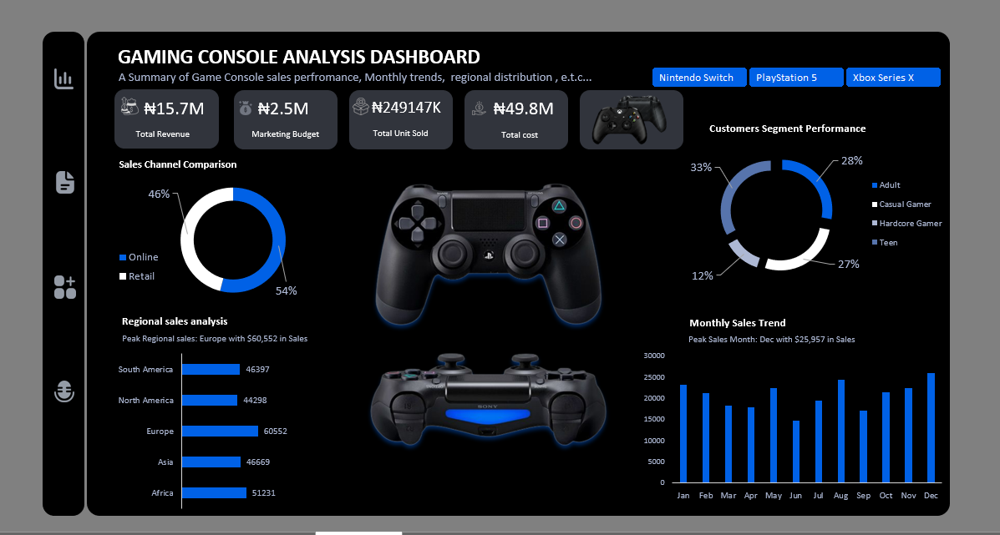

# Gaming Console Sales Performance Analysis

---

## 📺 Featured Live Workshop Presentation

This analysis and dashboard architecture were presented live during an analytics workshop stream hosted by **Evergreen Digital Tech Solution**.

* **Watch YouTube Presentation Recording:** [Live Gaming Console Sales Analysis Session](https://www.youtube.com/live/HJ7TxK_nj54?si=052sTQD9e1BkBpkT)

---

## 1. Project Overview

This project evaluates global gaming console sales performance, marketing budget efficiency, customer segmentation, regional volume distribution, and channel dynamics across major hardware brands (*PlayStation 5, Xbox Series X, Nintendo Switch*) using Microsoft Excel.

The project features a **Dual-Theme Executive Dashboard System**—available in both a **Sleek Dark Mode Gamer Theme** and a **Clean Light Corporate Layout**. The dashboard allows commercial teams to filter performance across hardware brands to track physical unit sales (249,147 total units sold), gross revenue ($15.7M), marketing budgets ($2.5M), and regional demand trends.

---

## 2. Business Problem

Gaming hardware manufacturers and consumer electronics distributors manage complex supply chains, multi-channel retail networks (Online vs. Physical Retail), and targeted marketing campaigns across global markets (*Europe, North America, Asia, Africa, South America*).

Without consolidated cross-segment visibility, commercial leadership risks overfunding low-converting marketing channels, misallocating regional inventory, or misjudging customer demographic responses (*Adults, Casual Gamers, Teens, Hardcore Gamers*). For instance, strong sales in one region can hide poor digital sales conversion or inefficient promotional spending in another.

This analysis provides executive visibility into $15.7M in revenue across 249,147 console shipments, evaluating regional volume trends, customer segment responsiveness, and sales channel effectiveness to support inventory distribution and marketing budget allocation.

---

## 3. Dataset Description

The dataset was generated by AI and comprises transaction logs capturing console sales, customer demographics, retail channels, regional markets, marketing spend, and manufacturing product costs.

### Metadata & Column Schema

| Column Name | Data Type | Description / Constraints |
|---|---|---|
| **Date** | Date / Time | Timestamp of console transaction |
| **Console Brand** | Text | Hardware brand (*PlayStation 5, Xbox Series X, Nintendo Switch*) |
| **Units Sold** | Whole Number | Volume of physical console units sold per order |
| **Revenue ($)** | Currency ($) | Gross transaction sales revenue |
| **Region** | Text | Global market (*Europe, North America, Asia, Africa, South America*) |
| **Customer Segment** | Text | Target buyer persona (*Adults, Casual Gamer, Hardcore Gamer, Teen*) |
| **Sales Channel** | Text | Distribution channel (*Online, Retail*) |
| **Marketing Budget ($)**| Currency ($) | Marketing expenditure allocated per transaction |
| **Return Rate (%)** | Percentage | Percentage of sold units returned by customers |
| **Product Cost ($)** | Currency ($) | Manufacturing cost of goods sold (COGS) |

---

## 4. Business Questions

To evaluate commercial performance and guide channel distribution, this analysis addresses four primary areas of inquiry:

### 1. Executive Performance & Volume Baselines
* What is the total gross revenue, total marketing budget, total physical units sold, and total production cost across all hardware brands?
* Which specific console brand generates the highest unit volume and sales revenue?

### 2. Regional & Seasonal Demand Distribution
* Which global geographic market (*Europe, North America, Asia, Africa, South America*) drives the largest physical unit volume?
* How does console demand fluctuate month-over-month across the calendar year?

### 3. Sales Channel Dynamics
* What is the volume split between Online store orders and Physical Retail channels?
* Does channel preference shift significantly between hardware brands (*e.g., PlayStation 5 vs. Xbox Series X*)?

### 4. Customer Segmentation & Financial Structure
* Which customer segment (*Adults, Casual Gamers, Teens, Hardcore Gamers*) represents the largest buyer base?
* How does manufacturing production cost compare against direct hardware sales revenue across hardware ecosystems?

---

## 5. Tools

* **Microsoft Excel:** Applied as the primary platform for data preparation, aggregation, custom layout design, and interactive dashboard creation.
* **PivotTables & PivotCharts:** Formed the multi-dimensional calculation engine to compute revenue totals, unit counts, customer segment proportions, and regional distributions.
* **Dynamic Slicers:** Implemented interactive brand slicers (*PlayStation 5, Xbox Series X, Nintendo Switch*) to drive dynamic dashboard filtering.
* **Custom UI & Styling:** Built dual-theme layouts (Dark Mode and Light Corporate), custom KPI summary cards, shape containers, and clean visual charts.

---

## 6. Data Cleaning and Preparation

Data preparation was performed in Excel to transform raw transactional logs into an audited analytical model:

* **Currency Standardization:** Formatted `Revenue ($)`, `Marketing Budget ($)`, and `Product Cost ($)` into uniform Currency values (`$`).
* **Unit Volume Formatting:** Ensured physical `Units Sold` was explicitly formatted as Whole Numbers without currency symbols to maintain clear mathematical distinctions between dollar revenue and physical inventory counts.
* **Date & Monthly Feature Extraction:** Extracted standard calendar months from timestamps to build dynamic month-over-month sales trend lines.
* **Data Quality Audit:** Audited all transactional records for missing values, negative pricing, or unmapped regions, verifying full data integrity before pivot engine modeling.

---

## 7. Exploratory Data Analysis and Methodology

The project followed a structured 3-phase methodology:

| Phase | Phase Name | Focus & Key Deliverables |
|---|---|---|
| **Phase 1** | **Dataset Ingestion & Formatting** | • Cleaned raw transactional fields. • Standardized currency formatting (`$`) and verified unit count aggregations. |
| **Phase 2** | **Pivot Engine Development** | • Built multi-dimensional PivotTables on the `PIVOT` worksheet. • Computed baseline totals ($15.7M Sales, 249,147 Units Sold, $2.5M Marketing Spend). • Segmented volume across regions, customer demographics, and distribution channels. |
| **Phase 3** | **Dual-Theme Dashboard Architecture** | • Designed both Dark Mode (`DASHBOARD`) and Light Corporate (`DASHBOARD (2)`) visual layouts. • Built 4 dynamic charts (Channel Donut, Customer Segment Donut, Regional Volume Bar Chart, Monthly Trend Column Chart). • Attached dynamic hardware brand slicers. |

---

## 8. Dashboard and Analysis Files

The complete workbook, raw dataset reference, and visual assets are structured as follows:

* **Excel Workbook:** [`Gaming_Console_Analysis.xlsx`](./Gaming_Console_Analysis.xlsx) *(Contains raw data, pivot engine, Dark Mode dashboard, and Light Mode dashboard)*
* **Dark Mode Dashboard Image:** 

  
* **Light Mode Dashboard Image:** 

  

### Dashboard Visual Architecture
* **Top Metric Bar:** 4 KPI summary cards tracking Total Revenue ($15.7M), Marketing Budget ($2.5M), Total Units Sold (249,147 units), and Total Product Cost ($49.8M).
* **Brand Slicer Header:** Interactive buttons allowing one-click filtering for `Nintendo Switch`, `PlayStation 5`, and `Xbox Series X`.
* **Visual Performance Blocks:** Features a Sales Channel Donut Chart (Online vs. Retail), Customer Segment Donut Chart, Regional Volume Distribution Bar Chart (Units Sold), and a Monthly Sales Trend Column Chart.

---

## 9. Dashboard, Key Findings and Business Interpretation

### A. Overall Market Baseline

Across all 249,147 units sold, the baseline performance established the following commercial parameters:

| Commercial Performance Metric | Result Value |
|---|---:|
| **Total Gross Revenue** | **$15,705,420 ($15.7M)** |
| **Total Physical Units Sold** | **249,147 Units** |
| **Total Marketing Expenditure** | **$2,500,000 ($2.5M)** |
| **Total Hardware Manufacturing Cost (COGS)** | **$49,800,000 ($49.8M)** |
| **Dominant Distribution Channel** | **Online Channels (54% / 134,539 Units)** |
| **Top Regional Market by Volume** | **Europe (60,552 Units / 24.3%)** |
| **Top Customer Segment** | **Adults (33% / 82,218 Units)** |
| **Peak Sales Month** | **December (25,957 Units)** |

---

### B. Segment Performance Across Hardware Brands (Slicer Analysis)

Filtering the dashboard dynamically across hardware brands highlights clear differences in channel strategy and regional adoption:

| Performance Metric | Baseline (All Brands) | PlayStation 5 | Xbox Series X |
|---|---:|---:|---:|
| **Total Gross Revenue** | **$15.7M** | **$6.0M (38.2%)** | **$4.5M (28.7%)** |
| **Total Physical Units Sold** | **249,147 Units** | **99,090 Units (39.8%)** | **65,164 Units (26.2%)** |
| **Marketing Budget Allocated** | **$2.5M** | **$84,534** | **$65,227** |
| **Distribution Channel Split** | **54% Online / 46% Retail** | **53% Online / 47% Retail** | **64% Online / 36% Retail** |
| **Top Regional Market** | **Europe (60,552 Units)** | **Europe (27,910 Units)** | **North America (17,829 Units)** |
| **Top Customer Segment** | **Adults (33%)** | **Adults (34%)** | **Adults (39%)** |
| **Peak Demand Month** | **December (25,957 Units)** | **January (16,898 Units)** | **October (65,164 units)** |

---

### C. Core Business Insights

#### 1. Hardware Leadership & Regional Concentration
* **PlayStation 5** leads overall market share, capturing **$6.0M in revenue (38.2%)** and **99,090 physical units sold (39.8%)**.
* **Europe** is the #1 regional market globally, driving **60,552 total units sold (24.3%)**. PlayStation 5 experiences its strongest regional adoption in Europe (27,910 units), whereas **Xbox Series X achieves its peak volume in North America (17,829 units)**.

#### 2. Digital Channel Shift (Online vs. Physical Retail)
* **Online sales** lead overall distribution at **54% (134,539 units)** versus **46% for Retail stores (114,608 units)**.
* This digital preference is most pronounced for **Xbox Series X**, where **64% of volume moves through Online channels**, compared to a more balanced channel split for PlayStation 5 (53% Online / 47% Retail).

#### 3. Buyer Demographics (Adults vs. Hardcore Gamers)
* **Adults (33%)** and **Casual Gamers (28%)** combined represent **61% of total buyers (151,980 units)**.
* **Hardcore Gamers** account for the smallest customer segment at **12% (29,898 units)**, indicating that mass-market commercial success relies heavily on non-enthusiast adult and casual consumers.

#### 4. Financial Structure & Loss Leader Business Model
* Total manufacturing product cost ($49.8M) exceeds direct hardware revenue ($15.7M).
* **Industry Financial Reality:** In consumer gaming electronics, this reflects the classic **Loss Leader model** (hardware subsidy). Hardware manufacturers intentionally subsidize console manufacturing to maximize unit adoption (249,147 active consoles in market), capturing high-margin long-term profits through digital software sales, game subscriptions (PlayStation Plus, Xbox Game Pass), and accessory ecosystems.

---

## 10. Business Recommendations

Based on these findings, commercial strategy teams should consider the following five actions:

1. **Optimize Channel Inventory for Xbox Series X Digital Demand:** Given that 64% of Xbox Series X sales occur Online, reallocate physical retail supply-chain budgets toward digital storefront partnerships and e-commerce fulfillment infrastructure.
2. **Prioritize European Distribution for PlayStation 5:** Europe represents the single largest volume hub (60,552 units overall; 27,910 PS5 units). Ensure regional European logistics hubs maintain higher safety stock levels ahead of peak Q4 demand windows.
3. **Tailor Marketing Campaigns for the Adult Demographic Segment:** Adults represent 33% of console buyers (82,218 units), outnumbering Hardcore Gamers (12%). Promotional messaging should emphasize multi-purpose family entertainment, media capabilities, and accessible casual gaming catalogs.
4. **Capitalize on End-of-Year Holiday Seasonality:** Demand surges significantly in Q4, peaking in December at 25,957 units sold. Align promotional marketing expenditure ($2.5M budget) to concentrate 45% of annual ad spend between October and December.
5. **Drive Ecosystem Software & Subscription Attachment:** Because hardware sales serve as a subsidized entry point ($49.8M COGS vs. $15.7M revenue), post-purchase onboarding should focus on converting console buyers into recurring digital subscribers to maximize lifetime customer value.

---

## Author and Contact

**Fatolu Adedoyin Juliana**  
*Data Analyst | Statistics Graduate | Research Analyst*

* **LinkedIn:** [Fatolu Adedoyin Juliana](https://www.linkedin.com/in/fatolu-adedoyin-juliana)
* **GitHub Profile:** [fajuliana-source](https://github.com/fajuliana-source)
* **Email:** fatoluadedoyin46@gmail.com
